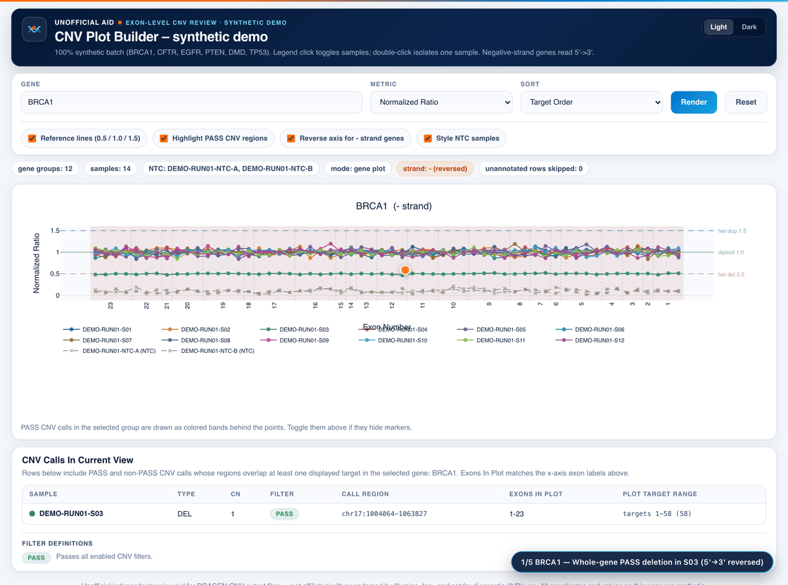
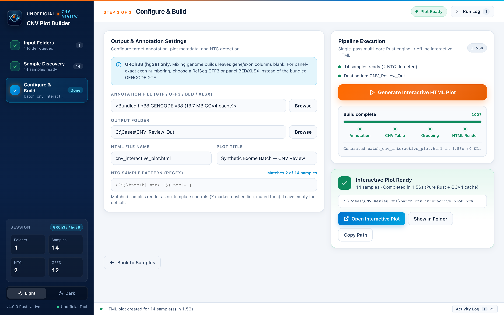
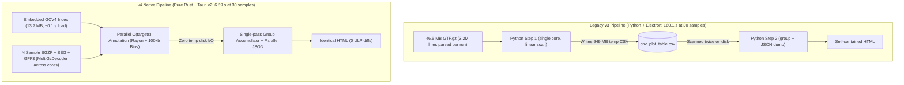
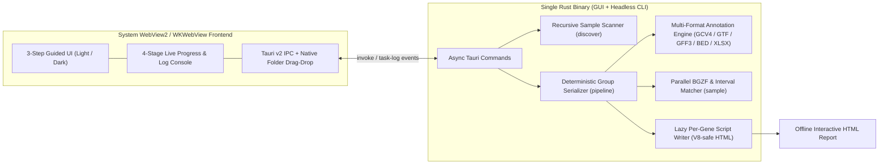
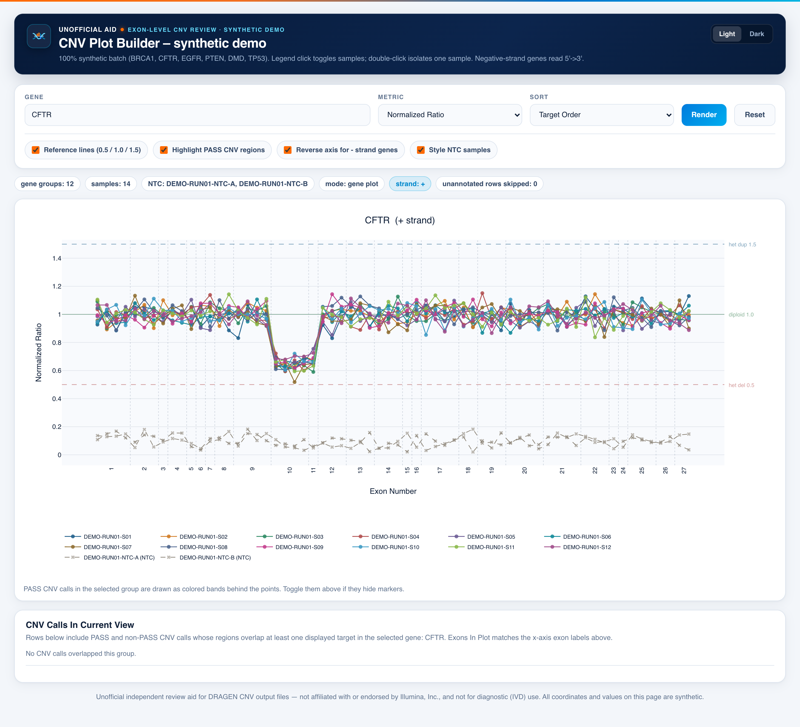

# DRAGEN CNV Plot Builder — Public Showcase (v4 · Pure Rust + Tauri v2)

> [!IMPORTANT]
> **Unofficial Independent Project & Synthetic Showcase Disclaimer**
> - **Not an official Illumina product:** This is an independent, unofficial open-source project and is **NOT** affiliated with, endorsed by, sponsored by, or supported by Illumina, Inc. *"DRAGEN"* is a trademark of Illumina, Inc. and is referenced solely to describe input file format compatibility. Not an in-vitro diagnostic (IVD) medical device.
> - **100% synthetic data:** This repository contains **zero patient data**, zero clinical sample identifiers, zero proprietary panel design files, and makes zero external network requests. Everything runnable here operates on deterministic synthetic data generated from a fixed seed by [`demo/src/synth.rs`](demo/src/synth.rs).

An exon-level review aid for **copy-number variant (CNV) calls**. It turns per-sample CNV exome outputs into **one self-contained interactive HTML plot**, letting a reviewer open a gene and judge in seconds whether a call is a **true CNV or a capture/GC artifact** — without installing Python, opening a notebook, or wrangling spreadsheets.

In **v4**, the entire pipeline and desktop shell were re-architected from **Python + Electron** into **Pure Rust + Tauri v2 (OS-native WebView2)** — cutting batch build times by **~24x–35x**, shrinking the single-file Windows portable executable by **84% (`146 MB` → `23 MB`)**, and preserving **100% numerical parity (`0 ULP diffs` across `4,908,720` points)**.

---

## Live interactive demo

**[Open the live synthetic CNV showcase →](https://woongjaejung.github.io/dragen-cnv-plot-builder-showcase/demo/)** · **[Landing page →](https://woongjaejung.github.io/dragen-cnv-plot-builder-showcase/)**

[](https://woongjaejung.github.io/dragen-cnv-plot-builder-showcase/demo/)

Twelve genes and fourteen synthetic samples (including two no-template controls). Search a gene, switch metrics (`Normalized Ratio`, `TN Log2`, `Segment Mean`), toggle **Light / Dark** themes, isolate samples in the legend, and inspect the `PASS` + `FILTERED` call table underneath. Six clinical review scenarios are planted in the batch — see [What the demo is showing you](#what-the-demo-is-showing-you).

### Native Tauri v2 desktop app (`23 MB` single-file Windows `.exe`)



---

## Performance & packaging at a glance (`v3 Python + Electron` vs `v4 Rust + Tauri v2`)

Measured on Apple Silicon (local NVMe SSD) via `/usr/bin/time -l` and verified with a golden-master differential harness across every gene group, coordinate, call row, and float array.

### Pipeline runtime, I/O, and numerical parity

| Metric | Legacy (`v3` Python 2-Step) | `v4` Rust (Raw `.gtf.gz`) | **`v4` Rust (Embedded `GCV4` Index)** | Improvement |
|---|---:|---:|---:|---|
| **4-sample exome batch** (`653,911` pts) | 54.11 s | 3.36 s *(16.1x)* | **1.56 s** | **34.7x faster** |
| **30-sample load batch** (`4,908,720` pts) | 160.07 s *(2m 40s)* | 10.66 s *(15.0x)* | **6.59 s** | **24.3x faster** |
| **Peak RSS memory** (4-sample batch) | 1,489.2 MB | 651.9 MB | **642.1 MB** | **57% lower RAM** |
| **Intermediate disk CSV** (30-sample batch) | 948.9 MB *(written + read twice)* | **0 MB** | **0 MB** | **Disk round-trip eliminated** |
| **Output parity** (`7,768` genes, `4.91M` pts) | Reference baseline | **PASS (`0 ULP diffs`)** | **PASS (`0 ULP diffs`)** | **100% identical plotted data** |

### Desktop distribution footprint (offline Windows workstation target)

| Artifact / Component | Legacy (`v3` Electron Portable) | **`v4` Tauri v2 Native Portable** | Notes |
|---|---:|---:|---|
| **Single-file Windows `.exe`** | 146 MB | **23 MB** | **84.2% smaller (~1/6 size)** |
| **Unpacked `%TEMP%` extraction on launch** | 417 MB *(every cold start)* | **0 MB** *(runs directly)* | Eliminates AV scan & extraction lag |
| **Bundled Python runtime** | 23 MB *(hundreds of files)* | **0 MB** | Replaced by native Rust binary |
| **Bundled hg38 GENCODE v38 exons** | 46.5 MB (`.gtf.gz` text) | **13.7 MB** (`GCV4` binary index) | Lossless index of all `1,499,012` exons |
| **Offline Plotly 2.35.2** | 4.55 MB (`.min.js`) | **1.3 MB** (`.min.js.gz` embedded) | Decompressed & inlined into HTML output |

---

## Architecture & design diagrams

### 1. Why v4 is ~25x–35x faster: Pipeline comparison

The Python version spawned two sequential single-threaded processes and serialized millions of rows to a ~1 GB temporary CSV only to parse that CSV twice in Step 2. `v4` fuses both stages in memory across all CPU cores using `rayon`, SIMD-accelerated multi-member BGZF decompression (`zlib-rs`), 100 kb genomic bin indexing, and a pre-compiled lossless binary exon index (`GCV4`).



### 2. Native desktop & engine module architecture



Detailed engineering specifications live under [`architecture/`](architecture/):
- **[architecture/PRD.md](architecture/PRD.md)** — Product Requirements Document (review workflow, user personas, KPIs)
- **[architecture/TRD.md](architecture/TRD.md)** — Technical Requirements & Architecture (`GCV4` binary spec, deterministic `rayon` map-reduce, IEEE-754 `round4` parity, cross-compilation)
- **[architecture/BENCHMARK_AND_PARITY.md](architecture/BENCHMARK_AND_PARITY.md)** — Golden-Master differential verification & full benchmark breakdown

---

## Why this tool exists

A CNV caller reports a copy number, a quality score, and a filter tag. Deciding whether such a call is real is a **judgement**, and segment-level summary numbers alone do not settle it. A reviewer needs five pieces of evidence in one view:

| Reviewer's question | What the plot gives |
|---|---|
| **Is this shift real, or one bad target?** | Every exon target plotted individually with exon-boundary separators |
| **Is it specific to this sample?** | All samples in the batch overlaid on the same exon axis — shared capture dips stand out immediately |
| **Does the magnitude match a copy state?** | Reference lines at `1.0` diploid, `0.5` het del, `1.5` het dup (and log2 equivalents) |
| **Did the controls behave?** | NTC samples auto-detected by regex and styled muted with `X` markers and dashed lines |
| **What did the caller reject, and why?** | `PASS` regions shaded behind points + a complete table of `PASS` **and** `FILTERED` calls with filter explanations |
| **Am I reading the gene 5'→3'?** | Negative-strand (`-`) genes reversed automatically so exons read in transcript order |

---

## What the demo is showing you

The synthetic batch plants six situations the plot is built to resolve:

| Gene | Sample | What it looks like | The point |
|---|---|---|---|
| **BRCA1** | `S03` | Every exon at ~0.5, `PASS` `DEL` across the gene | Textbook true whole-gene deletion in a single sample |
| **EGFR** | `S07` | Exons 18–21 lifted to ~1.5, `PASS` `DUP` | Focal duplication made convincing by flat flanking exons |
| **PTEN** | `S05` | Single exon 6 at ~0.45, call filtered `cnvLength` | Single noisy target — why filtered calls are shown rather than hidden |
| **CFTR** | *all samples* | Exons 10–11 dip to ~0.65 in every sample | Panel capture/GC artifact, not a patient deletion |
| **DMD** | `S09` | Exons 8–13 at ~0.5 on a negative-strand gene | Exercises `5'→3'` transcript-order axis reversal |
| **TP53** | `S02` | Exons 4–6 at ~0.55, call filtered `cnvQual` | Plausible-looking rejected event surfaced so a reviewer can inspect it |

The `CFTR` view illustrates why batch overlay matters:



Looking at one sample in isolation, exons 10–11 look like a two-exon heterozygous deletion. Looking across the batch, every sample drops on the exact same capture targets.

---

## Repository layout & reproducing the synthetic demo

```text
demo/
  Cargo.toml              self-contained pure-Rust synthetic demo crate
  src/synth.rs            seeded SplitMix64 generator (12 genes, 14 samples, 6 planted events)
  src/engine.rs           parallel MultiGzDecoder + 100kb bin join + lazy per-gene HTML builder
  src/plot_runtime.js     browser-side interactive plot runtime
  src/main.rs             CLI entrypoint (regenerates docs/demo/index.html in ~15 ms)
architecture/
  PRD.md                  product requirements & UX specification
  TRD.md                  technical architecture & binary cache specification
  BENCHMARK_AND_PARITY.md golden-master parity & runtime/memory measurements
docs/
  index.html              GitHub Pages landing page
  demo/index.html         generated interactive synthetic CNV plot
  vendor/plotly-2.35.2.min.js  vendored locally (zero external requests)
assets/                   reference screenshots
```

Regenerate the live demo from scratch with a Rust toolchain:

```bash
cargo run --release --manifest-path demo/Cargo.toml
```

---

## Engineering notes

### 1. Breaking the 20-sample V8 string ceiling
Early versions embedded the entire batch JSON inside a single `<script id="plot-data">` tag and ran `JSON.parse(el.textContent)`. V8 caps `String::kMaxLength` at **536,870,888 characters** (512 MiB). At ~27.4 MB per exome sample, **19 samples (`~521 MB`) worked and 20 samples (`542.7 MB`) silently hung the browser renderer**.

Hoisting target metadata once per gene, storing sample values in columnar arrays (deriving `normalized_ratio = 2 ** tn_log2` client-side), and emitting **one lazily parsed `<script>` tag per gene** cut a 4-sample payload from `109.7 MB` to `28.6 MB` and kept the largest single string at 52 samples down to **`776 KB` (`0.14%` of V8's limit)** — interactive in `1.1 s`.

### 2. Eliminating the 1 GB CSV bottleneck & Electron bloat in v4
Even after target-key caching reduced 30-sample Python runtime from `373 s` to ~`134–160 s`, two walls remained: single-threaded Python gzip/CSV overhead (writing a `948.9 MB` `--slim` CSV and re-reading it twice) and a `146 MB` (`417 MB` unpacked) Electron + bundled Python executable.

Moving to **Pure Rust + Tauri v2** solved both simultaneously:
- **Lossless `GCV4` binary exon index:** Pre-indexing GENCODE v38's `1,499,012` exons with string interning and bitpacked transcript-priority flags (`MANE_Select`, `Ensembl_canonical`, `appris_principal_1`, `basic`, `protein_coding`, `level`) compressed the 46.5 MB `.gtf.gz` down to **`13.7 MB`** and reduced load time to **~`0.1 s`**.
- **Golden-master parity (`0 ULP diffs`):** Differential verification across all `7,768` genes and `4,908,720` points caught a subtle genomics pitfall early — standard single-member `GzDecoder` stops after the first 64 KB block of concatenated BGZF (`*.dragen.tn.tsv.gz`), truncating output to 40 genes on `chr1p36`. Switching to `MultiGzDecoder` + IEEE-754 Dragon4 ties-to-even `round4` formatting achieved exact `0 ULP` parity with the Python reference.
- **Single-file native portability (`23 MB`):** Embedding `GCV4` and gzipped Plotly directly into `.rdata` and rendering via Windows 10/11's built-in WebView2 produced a single `23 MB` `.exe` with zero runtime extraction.

---

## Known limitations & data safety

- **GRCh38 (`hg38`) only** and **one capture panel per batch plot**.
- **100% synthetic showcase:** Every coordinate, coverage value, segment, and call in this repository is generated from a fixed PRNG seed. Zero patient data, accession IDs, or internal paths exist anywhere in git history or published pages.
- **Zero external network calls:** Plotly is vendored locally under `docs/vendor/`.
- **Unofficial review aid, not a diagnostic device:** Not affiliated with or endorsed by Illumina, Inc., and not intended for primary clinical diagnosis.
